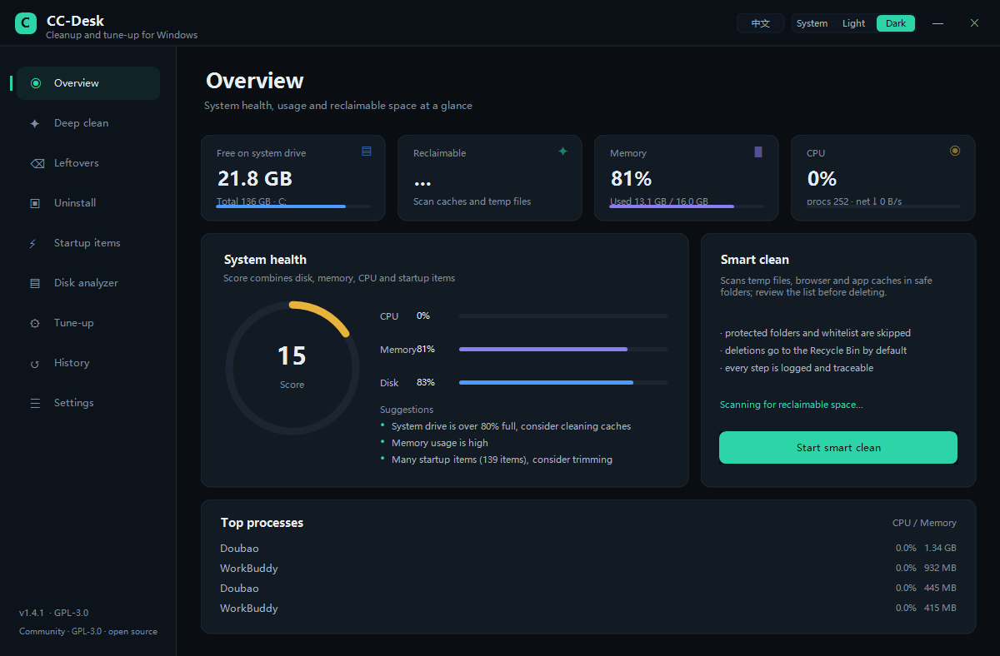
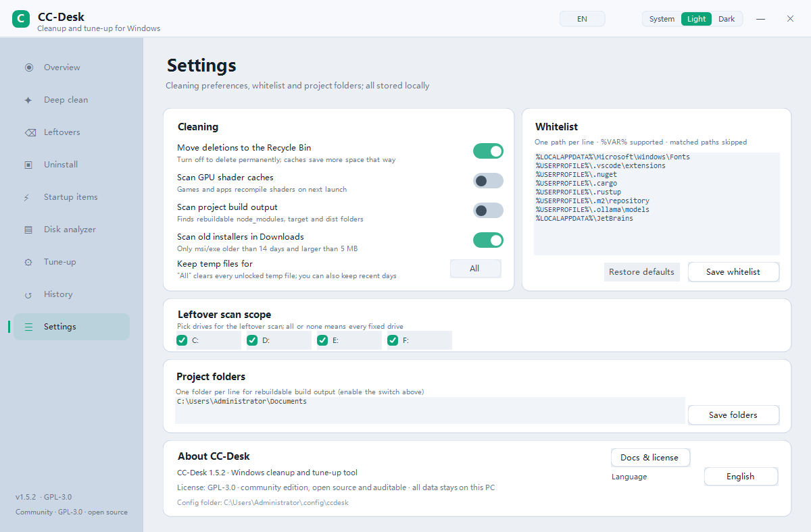
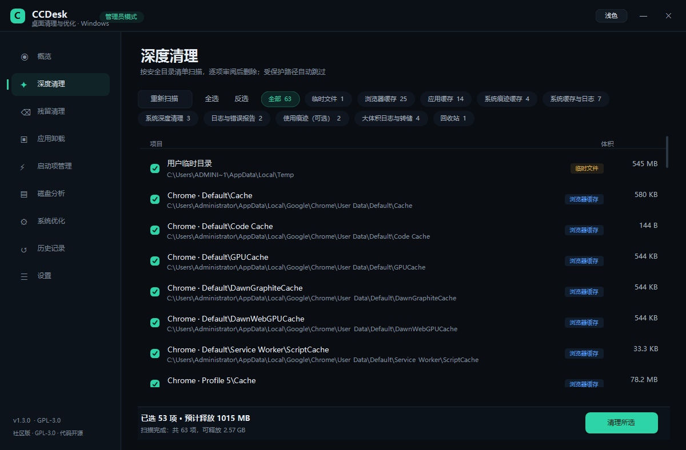
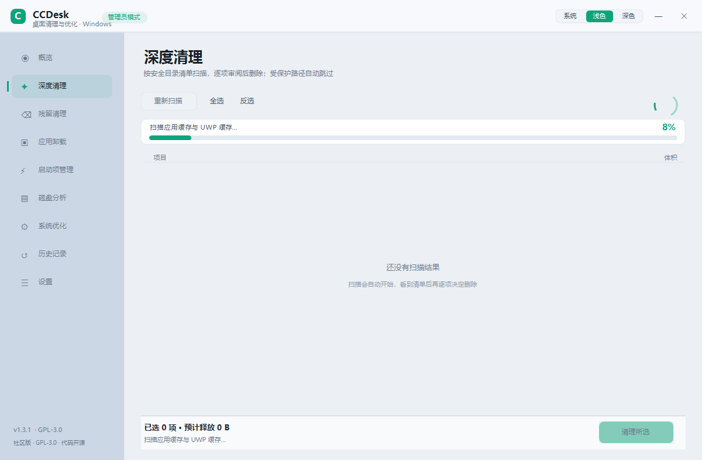
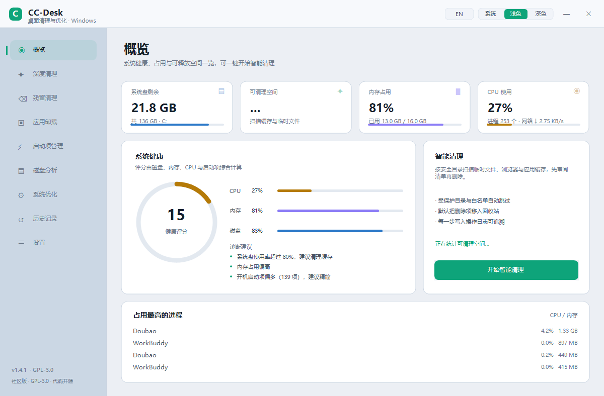
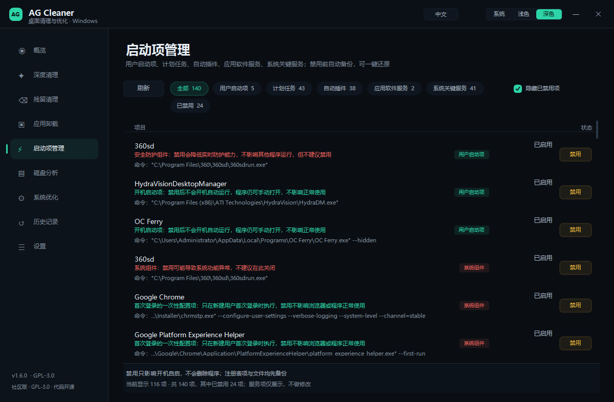

# AG Cleaner · Windows cleanup and tune-up

**One executable, double-click to run; everything it finds is listed for you first, and only deleted when you say so.**

Built for people who don't want a bundled suite or a ten-article tutorial to clear a cache. It opens on an overview (free space, memory, CPU, reclaimable space); "Smart clean" produces a list, you tick items, then it acts. The sidebar holds deep clean, leftovers, uninstall, startup items, disk analyzer, tune-up and history — one job per page, with light / dark themes.

## Download

Grab `AG-Cleaner.exe` (about 820 KB, portable) from [Releases](../../releases/latest).

- Requires the .NET Framework 4.8 shipped with Windows 10 / 11; no .NET SDK, no Node/Electron
- No network, nothing uploaded; config and logs stay in `%USERPROFILE%\.config\agcleaner`
- Not code-signed, so SmartScreen may warn on first run (More info → Run anyway); you can always build it yourself (see section 7)
- Chinese / English / Deutsch / Français / Русский / Español interfaces, one click in the title bar, remembered
- Usage notes, changelog, credits and licence are compiled into the exe (Settings → About → Notes & licence)
- Open source (GPL-3.0); this repository is the source

---

## Screenshots

| English · Overview | English · Settings (light) |
| --- | --- |
|  |  |

| Chinese · Deep clean (dark) | Chinese · Deep clean (light) |
| --- | --- |
|  |  |

| Light · Overview |
| --- |
|  |

| Startup items · six groups | Progress bar (above the list) |
| --- | --- |
|  |  |

---

## 1. Getting started

**Run it**: double-click `AG-Cleaner.exe`. System-level cleaning (Windows caches, event logs, update cache, deep clean) needs administrator rights; without them those items are skipped or flagged.

**Install locally**:

```powershell
powershell -ExecutionPolicy Bypass -File install.ps1
```

Installs to `%LOCALAPPDATA%\AGCleaner\` and creates desktop and Start menu shortcuts. Uninstall:

```powershell
powershell -ExecutionPolicy Bypass -File uninstall.ps1
```

**Theme**: the System / Light / Dark buttons at the top right of the title bar; the choice is remembered.

**Language**: the title-bar button shows the current language code (中文 / EN / DE / FR / RU / ES) and opens a menu with Chinese, English, Deutsch, Français, Русский and Español; the same entry sits on the right of the "About AG Cleaner" card in Settings. The choice is remembered.

Coverage: all six languages are complete — 650 strings per language, aligned one-to-one with the English table, with no fallback gaps. The four translations are the author's own — native speakers are welcome to send corrections.

---

## 2. Pages

| Page | What it does |
| --- | --- |
| Overview | Free disk space, reclaimable space, memory and CPU cards, health score and suggestions, top processes |
| Deep clean | 13 rule categories → category filter → item-by-item review → confirm → progress bar → full report |
| Leftovers | Orphan install folders (including D/E drives and drive roots), leftover registry keys, invalid uninstall entries, dead shortcuts, dead startup entries; deletions are recoverable |
| Uninstall | Enumerates installed apps from the registry, estimates size, calls the official uninstaller, rescans for leftovers afterwards |
| Startup items | User startup entries / scheduled tasks / plugins / app services / system services / disabled, six filters, optional "hide disabled"; backup before disabling, one-click restore |
| Disk analyzer | Drill-down, largest files, delete to the Recycle Bin, results stream in while scanning |
| Tune-up | DNS / ARP / TRIM / update cache / temp files / Recycle Bin, admin-only items are flagged |
| History | Operation timeline, CSV export, clear |
| Settings | Recycle Bin switch, GPU / project / installer scan switches, temp file age (all / 1 / 3 / 7 / 14 / 30 days), whitelist, project folders, UI language, about |

---

## 3. What gets cleaned

| Category | Main content | Default |
| --- | --- | --- |
| Temp files | User and local temp folders (unused files are deleted; can be limited to files older than N days in Settings) | checked |
| Browser caches | Chrome / Edge / Brave / Vivaldi / 360 / Quark / Firefox profiles: Cache, Code Cache, GPU cache, ShaderCache, Service Worker scripts, Crashpad, BrowserMetrics; other Chromium browsers are discovered automatically | checked |
| App caches | Chat and office app caches, auto-discovery for Electron apps, LocalCache / TempState of all UWP apps, WebView2 caches | checked |
| System trace caches | Thumbnail and icon databases, Explorer icon cache, Remote Desktop cache, theme thumbnails | checked |
| System caches and logs | Windows\Temp, update download cache, Windows\Logs (CBS / DISM / WindowsUpdate), event logs, font cache, Installer/INF logs, LogFiles, Minidump, Prefetch, WER, Panther, delivery optimization cache and logs, diagnostic data, update orchestrator logs, update reboot cache, update database logs, DriverStore\Temp, Defender scan history, Intel driver install cache, retail demo, WDI boot performance logs, OneDrive logs, LocalService temp, other accounts' Temp | checked (admin required) |
| Deep system clean | Windows.old, `$WINDOWS.~BT` / `$WINDOWS.~WS`, WinSxS\Temp, search index, Package Cache, MSI `$PatchCache$` | unchecked |
| Logs and error reports | Crash dumps, system and user error reports, MEMORY.DMP, Office file cache, IE / INetCache, Adobe Reader cache, WPS cache, several app logs | checked |
| Large logs and dumps | Single files over 48 MB and 3 days untouched: .log / .etl / .dmp / .mdmp / .cab / .evtx / .wer, with last write time and size | unchecked |
| Usage traces | Recent documents, notification history | unchecked |
| GPU shader caches | NVIDIA / AMD / Intel / DirectX caches | unchecked (Settings switch) |
| Old installers | msi / exe / msix / appx older than 14 days and larger than 5 MB in Downloads | checked (Settings switch) |
| Project build output | node_modules, target, dist, build, .next, venv and similar | unchecked (Settings switch) |
| Recycle Bin | Recycle Bin contents | unchecked |

---

## 4. How leftovers are judged

| Type | Rule | Action |
| --- | --- | --- |
| Orphan install folder | Scans Program Files / Program Files (x86) / Programs / drive roots on every fixed drive, plus AppData and ProgramData on the system drive; a folder referenced by no installed app and meeting one of: no file written in 90 days (high confidence), or containing a real uninstaller such as uninst.exe (possibly just uninstalled, needs your confirmation); larger than 20 MB. When a vendor parent folder is referenced, look one level inside and pick only the unreferenced children | Move to Recycle Bin |
| Leftover registry key | Keys two levels under HKLM / HKCU SOFTWARE whose values point to paths that no longer exist | Export .reg, then delete |
| Invalid uninstall entry | The exe behind the uninstall command is gone, and both InstallLocation and DisplayIcon are dead (msiexec entries are skipped) | Export .reg, then delete |
| Dead shortcut | .lnk targets on the desktop or Start menu that no longer exist | Move to Recycle Bin |
| Dead startup entry | Run entries pointing to a missing exe | Backup, then disable |

Judgement is heuristic, so everything is unchecked by default and you confirm item by item.

---

## 5. Safety design

1. **Protected roots**: `C:\Windows`, `C:\Program Files`, `C:\Program Files (x86)` and the Defender folder are never deleted; only explicitly listed children are allowed. `System32` and `WinSxS` themselves are always refused.
2. **Sensitive segments**: `.ssh`, `.gnupg`, `.aws`, `.kube`, `.docker`, browser Cookies / Login Data / Local Storage / IndexedDB, AI session records and similar are skipped automatically.
3. **Whitelist**: VS Code extensions, NuGet/Cargo caches, JetBrains and more are protected by default; editable in Settings.
4. **Review before delete**: scanning only produces a list, nothing runs automatically.
5. **Recoverable**: user-level items go to the Recycle Bin by default; registry entries are exported with `reg export` to `.config\agcleaner\backup` before deletion; startup entries are backed up before disabling and can be restored.
6. **Locked files**: files held by a service are scheduled for deletion on reboot (`MoveFileEx`) and counted honestly in the freed total.
7. **Audit**: every operation is written to `operations.log`; the History page can export CSV.

---

## 6. Command line

```
AG-Cleaner.exe                              normal launch
AG-Cleaner.exe --shot a.png 1 45000 [light|dark|system] [zh|en]    offscreen render for self-checks
AG-Cleaner.exe --scan scan.txt              dump categorized scan results
AG-Cleaner.exe --orphans orphans.txt        dump leftover scan results
AG-Cleaner.exe --selftest s.txt             safety guard and deletion path self-test
AG-Cleaner.exe --dlgshot d.png              offscreen render of the "clean finished" report
AG-Cleaner.exe --guard <path...>            path verdict (cleanable / protected / whitelisted / sensitive / trusted / exists)
AG-Cleaner.exe --startup s.txt              export startup items with per-character codes
```

---

## 7. Build

No .NET SDK needed; the bundled `csc.exe` is enough (the sources avoid C# 6+ syntax):

```powershell
powershell -ExecutionPolicy Bypass -File src\build.ps1 -Icon
```

The output is `dist\AG-Cleaner.exe`; the icon is generated from `assets\raw.png` into `assets\app.ico` by `src\makeicon.ps1`.

Source layout:

```
src/
  Theme.cs        palettes for light / dark / system skins, drawing helpers
  Controls.cs     custom-drawn control library and ThemeSync
  Lang.cs         bilingual string table (Chinese source string as key → English)
  MainForm.cs     window shell, sidebar, page routing, theme and language reload
  Dlg.cs          modal dialogs
  Program.cs      entry point, command line and self-checks
  Core/           guards, cleaning engine, leftovers, apps, startup, disk, tune-up
  Pages/          9 pages
```

---

## 8. Known limitations

- Event logs, font cache and the search index are held by system services; some space is only released after a reboot
- Not covered: `hiberfil.sys`, restore points, DISM component store cleanup (they need system settings or system commands, not silent GUI actions)
- System services in Startup items are read-only; start type changes are a system-level change the UI does not perform
- Scheduled tasks are enabled/disabled through `schtasks`, matching Task Scheduler itself
- Not code-signed, so SmartScreen may warn on first run
- The UI is designed for 96 DPI and looks small at 200% scaling

---

## 9. License and origin

GPL-3.0, see `LICENSE` and `NOTICE.md`. The project uses its own name and icon and has no affiliation, sponsorship or endorsement relationship with any upstream project.
