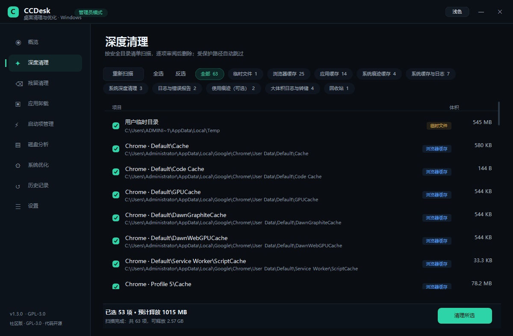
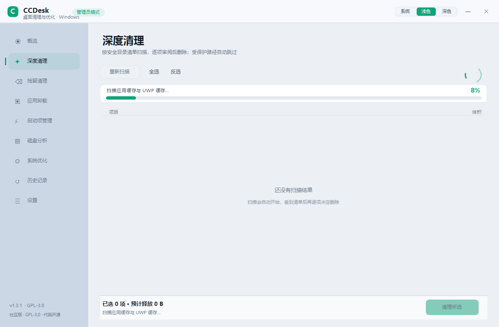
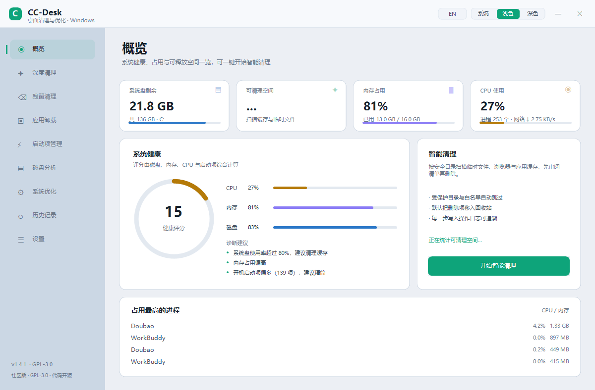
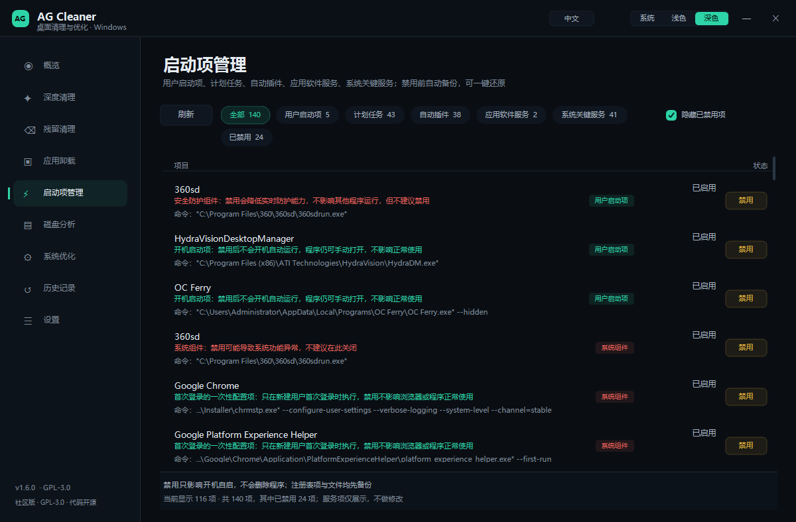

# CC-Desk · Windows 桌面清理与优化

原生 Windows 桌面清理工具：绿色单文件、深色/浅色双主题、**先审阅清单再删除**，扫描与清理全程显示百分比进度，覆盖系统级缓存、浏览器与应用缓存、系统痕迹、事件日志、内存转储、大体积日志，并提供“已卸载软件残留”的专页清理。

- 单文件可执行，约 370 KB；不用 .NET SDK、不用 Node/Electron
- 运行依赖：Windows 10 / 11 自带的 .NET Framework 4.8
- 不联网、不上传任何清单；配置与日志只写本地 `%USERPROFILE%\.config\ccdesk`
- 中文 / English / Deutsch / Français / Русский / Español 六种界面语言，顶栏一键切换，选择会记住（英文说明见 [README.en.md](README.en.md)）
- 代码开源（GPL-3.0），源码随包提供

---

## 界面

| 深色 · 深度清理 | 浅色 · 深度清理 |
| --- | --- |
|  |  |

| 浅色 · 概览 |
| --- |
|  |

| 启动项管理 · 五类筛选 | 进度条（列表上方） |
| --- | --- |
|  |  |

---

## 一、快速开始

**直接运行**：双击 `CCDesk.exe`。系统级清理（Windows 缓存、事件日志、更新缓存、深度清理）需要管理员权限，非管理员时这些项会被跳过或标注。

**安装到本机**：

```powershell
powershell -ExecutionPolicy Bypass -File install.ps1
```

安装到 `%LOCALAPPDATA%\CCDesk\`，并创建桌面与开始菜单快捷方式。卸载：

```powershell
powershell -ExecutionPolicy Bypass -File uninstall.ps1
```

**切换主题**：标题栏右上角「浅色 / 深色 / 系统」按钮，选择会记住。

**切换语言**：标题栏右侧的语言按钮显示当前语言代码（中文 / EN / DE / FR / RU / ES），点开是六种语言的列表（中文、English、Deutsch、Français、Русский、Español），选中立即生效；设置页「关于」卡片右侧有同样的入口。选择会记住。

语言覆盖度：中、英、德、法、俄、西六套均为全量（每套 650 条词条，与英文一键对齐，无回落缺口）。四套小语种为作者自译，欢迎 native speaker 提 PR 校对。

---

## 二、页面

| 页面 | 能力 |
| --- | --- |
| 概览 | 磁盘剩余、可清理空间、内存、CPU 实时卡，健康评分与诊断建议，Top 进程 |
| 深度清理 | 13 类规则扫描 → 分类筛选 → 逐项勾选审阅 → 确认后执行 → 进度条 → 完整明细报告 |
| 残留清理 | 孤儿安装目录（含 D/E 盘与盘根目录）、残留注册表键、无效卸载项、失效快捷方式、失效启动项；删除可恢复 |
| 应用卸载 | 注册表枚举已装程序、体积估算、调用官方卸载器、卸载后残留扫描 |
| 启动项管理 | 用户启动项 / 计划任务 / 自动插件 / 应用软件服务 / 系统关键服务 / 已禁用 六类筛选，可隐藏已禁用项；禁用前备份，可一键还原 |
| 磁盘分析 | 逐层下钻、大文件排行、删除进回收站，边扫描边出结果 |
| 系统优化 | DNS / ARP / TRIM / 更新缓存 / 临时文件 / 回收站 六项，管理员项会标注 |
| 历史记录 | 操作时间线、导出 CSV、清空 |
| 设置 | 回收站开关、GPU/项目/安装包扫描开关、临时文件天数（全部/1/3/7/14/30）、白名单、项目目录、界面语言切换、关于 |

---

## 三、清理规则

| 分类 | 主要内容 | 默认 |
| --- | --- | --- |
| 临时文件 | 用户临时目录、本地临时目录（默认清空未被占用的文件，可在设置里改成只清 N 天前） | 勾选 |
| 浏览器缓存 | Chrome / Edge / Brave / Vivaldi / 360 / 夸克 / Firefox 各 Profile 的 Cache、Code Cache、GPU 缓存、ShaderCache、Service Worker 脚本缓存、Crashpad、BrowserMetrics；其余 Chromium 浏览器自动发现 | 勾选 |
| 应用缓存 | 聊天办公软件缓存、Electron 类应用自动发现、所有 UWP 应用的 LocalCache / TempState、WebView2 缓存 | 勾选 |
| 系统痕迹缓存 | 缩略图与图标数据库、资源管理器图标缓存、远程桌面缓存、主题缩略图 | 勾选 |
| 系统缓存与日志 | Windows\Temp、更新下载缓存、Windows\Logs（含 CBS / DISM / WindowsUpdate）、事件日志、字体缓存、Installer/INF 日志、LogFiles、Minidump、Prefetch、WER、Panther、交付优化缓存与日志、诊断数据、更新协调日志、更新重启缓存、更新数据库日志、DriverStore\Temp、Defender 扫描历史、Intel 驱动安装缓存、零售演示、WDI 启动性能日志、OneDrive 日志、LocalService 临时目录、其他账号 Temp | 勾选（需管理员） |
| 系统深度清理 | Windows.old、`$WINDOWS.~BT` / `$WINDOWS.~WS`、WinSxS\Temp、搜索索引、Package Cache、MSI `$PatchCache$` | 不勾选 |
| 日志与错误报告 | 崩溃转储、系统级与用户级错误报告、MEMORY.DMP、Office 文件缓存、IE / INetCache、Adobe Reader 缓存、WPS 缓存、若干应用日志 | 勾选 |
| 大体积日志与转储 | 单文件大于 48 MB 且 3 天未更新的 .log / .etl / .dmp / .mdmp / .cab / .evtx / .wer，逐条显示最后写入时间与大小 | 不勾选 |
| 使用痕迹 | 最近使用的文档、通知中心历史 | 不勾选 |
| GPU 着色器缓存 | NVIDIA / AMD / Intel / DirectX 缓存 | 不勾选（设置开关） |
| 旧安装包 | 下载目录 14 天前、大于 5 MB 的 msi/exe/msix/appx | 勾选（设置开关） |
| 项目构建产物 | node_modules、target、dist、build、.next、venv 等 | 不勾选（设置开关） |
| 回收站 | 回收站内容 | 不勾选 |

---

## 四、残留清理的判定口径

| 类型 | 判定 | 处置 |
| --- | --- | --- |
| 孤儿安装目录 | 扫描所有固定磁盘的 Program Files / Program Files (x86) / Programs / 盘根目录与系统盘 AppData、ProgramData；目录无任何已安装程序引用，且满足其一：90 天无文件写入（高置信），或带真实卸载程序 uninst.exe 等（可能是刚卸载，需你确认）；体积大于 20 MB。厂商父目录被引用时往里看一层，只挑没被引用的子目录 | 移入回收站 |
| 残留注册表键 | HKLM / HKCU 的 SOFTWARE 下两层键，键值里出现已不存在目录的路径 | 导出 .reg 后删除 |
| 无效卸载项 | 卸载命令指向的 exe 已不存在，InstallLocation 与 DisplayIcon 也都失效（msiexec 项自动跳过） | 导出 .reg 后删除 |
| 失效快捷方式 | 桌面与开始菜单的 .lnk 目标路径不存在 | 移入回收站 |
| 失效启动项 | Run 键指向的 exe 不存在 | 备份后禁用 |

判定是启发式的，所以默认全部不勾选，由你逐条确认。

---

## 五、安全设计

1. **受保护根目录**：`C:\Windows`、`C:\Program Files`、`C:\Program Files (x86)`、Defender 目录一律不删，只放行明确列举的子路径。`System32` 与 `WinSxS` 本体始终拒绝。
2. **敏感片段拦截**：`.ssh`、`.gnupg`、`.aws`、`.kube`、`.docker`、浏览器 Cookies / Login Data / Local Storage / IndexedDB、AI 会话记录等，清理时自动跳过。
3. **白名单**：默认保护 VS Code 扩展、NuGet/Cargo 缓存、JetBrains 等，设置页可增删。
4. **先审阅后删除**：扫描只出清单，不自动执行。
5. **可恢复**：用户级项目默认进回收站；注册表项删除前 `reg export` 备份到 `.config\ccdesk\backup`；启动项禁用前备份，可还原。
6. **占用文件**：被服务占用的文件登记为重启后删除（`MoveFileEx`），并如实计入释放量。
7. **审计**：每次操作写入 `operations.log`，历史记录页可导出 CSV。

---

## 六、命令行

```
CCDesk.exe                              正常启动
CCDesk.exe --shot a.png 1 45000 [light|dark|system] [zh|en]    离屏渲染截图（自检用）
CCDesk.exe --scan scan.txt              输出分类扫描结果
CCDesk.exe --orphans orphans.txt        输出残留扫描结果
CCDesk.exe --selftest s.txt             安全护栏与删除链路自检
CCDesk.exe --dlgshot d.png              离屏渲染“清理完成”报告框
CCDesk.exe --guard <path...>            输出路径判定（可删/受保护/白名单/敏感/可信/存在）
CCDesk.exe --startup s.txt              导出启动项清单与逐字符编码（排查显示问题）
```

---

## 七、构建

本机不需要 .NET SDK，用系统自带的 csc.exe 即可（源码规避了 C# 6+ 语法）：

```powershell
powershell -ExecutionPolicy Bypass -File src\build.ps1 -Icon
```

产物为 `dist\CCDesk.exe`；图标由 `src\makeicon.ps1` 从 `assets\raw.png` 生成 `assets\app.ico`。

源码结构：

```
src/
  Theme.cs        深色/浅色两套配色与绘制工具
  Controls.cs     自绘控件库与 ThemeSync（切换配色时同步刷新控件底色）
  MainForm.cs     窗口骨架、侧栏、页面路由、主题切换
  Dlg.cs          模态对话框
  Program.cs      入口、命令行与自检
  Core/           安全护栏、清理引擎、残留检测、应用枚举、启动项、磁盘分析、系统优化
  Pages/          9 个页面
```

---

## 八、已知限制

- 事件日志、字体缓存、搜索索引被系统服务占用，部分需要重启才真正释放
- 未纳入：休眠文件 `hiberfil.sys`、系统还原点、DISM 组件存储清理（都需要改动系统设置或执行系统命令，不在图形界面里静默执行）
- 启动项里的系统服务只读展示，不做启停（改服务启动类型属于系统级变更，界面不代劳）
- 计划任务的启用/禁用通过 `schtasks` 完成，与系统自带任务计划程序一致
- 未做代码签名，首次运行可能触发 SmartScreen
- 界面按 96 DPI 设计，200% 缩放下偏小

---

## 九、许可与来源

GPL-3.0，见 `LICENSE` 与 `NOTICE.md`。项目为独立命名、独立图标，与上游项目不存在隶属、赞助或背书关系。
